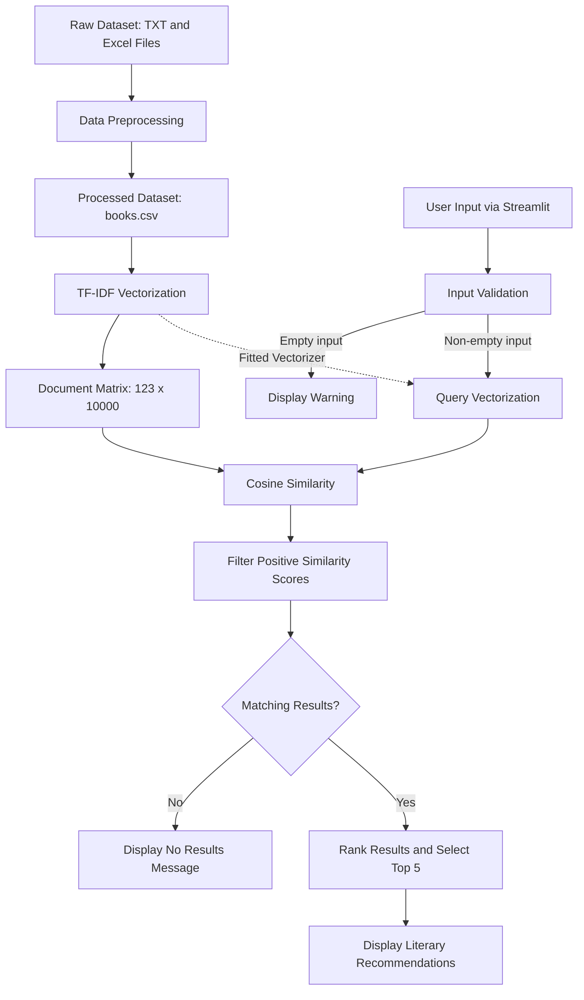
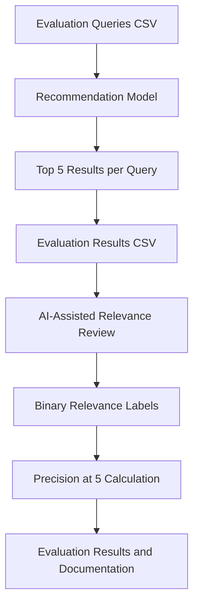

# LiteraMK-AI – System Architecture

## 1. Architecture Overview

LiteraMK-AI follows a modular architecture that separates data preparation, text representation, recommendation generation, user interaction, and evaluation.

## 2. System Architecture Diagram

## 3. System Components

| Component | Implementation | Responsibility |
|---|---|---|
| Data Inspection | inspect_data.py, inspect_text.py | Examine original data |
| Data Preprocessing | prepare_data.py | Clean and combine data |
| Data Validation | validate_data.py | Verify dataset structure |
| Baseline Model | baseline.py | Basic keyword search |
| Recommendation Model | recommender.py | TF-IDF and Cosine Similarity |
| User Interface | app.py | User input and recommendation display |
| Evaluation | evaluate.py | Generate evaluation results |
| Relevance Review | review_relevance.py | Extract text excerpts for review |
| Performance Metrics | calculate_metrics.py | Calculate Precision@5 |

## 4. Recommendation Workflow

1. Load the processed literary dataset.
2. Fit the TF-IDF vectorizer using literary texts.
3. Generate the document matrix.
4. Receive thematic keywords from the user.
5. Validate and normalize the user input.
6. Transform the query using the fitted TF-IDF vectorizer.
7. Calculate Cosine Similarity between the query and documents.
8. Remove results with zero similarity.
9. Rank the remaining results in descending order.
10. Display up to five literary recommendations.

## 5. Input Validation and Error Handling

- Empty input: Display a warning message.
- Unknown keywords: Display a no-results message.
- Valid input: Generate ranked recommendations.
- Uppercase input: Normalize to lowercase before processing.

## 6. Evaluation Workflow

The evaluation process is performed separately from the user interface.

Five thematic queries were used to generate 25 recommendations.

Under the selected AI-assisted relevance criteria, 24 recommendations were classified as relevant, producing an average Precision@5 of 96%.

The relevance labels require independent human verification.

## 7. Current Architecture Limitations

- The application runs locally.
- The system does not use a database server.
- The model relies on lexical rather than semantic similarity.
- User profiles and personalized learning are not implemented.
- Public deployment and security testing remain unverified.
- Independent relevance assessment has not yet been conducted.

## 8. Conclusion

The modular architecture provides a functional foundation for Macedonian literary recommendations and supports future improvements in data processing, recommendation quality, evaluation, and user interaction.
